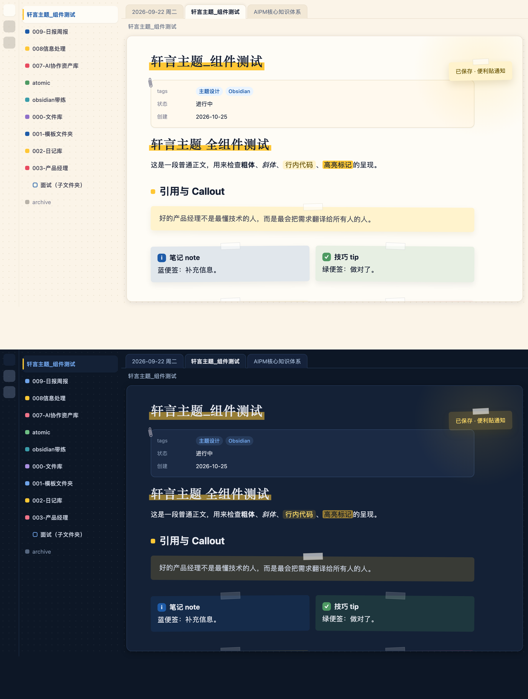
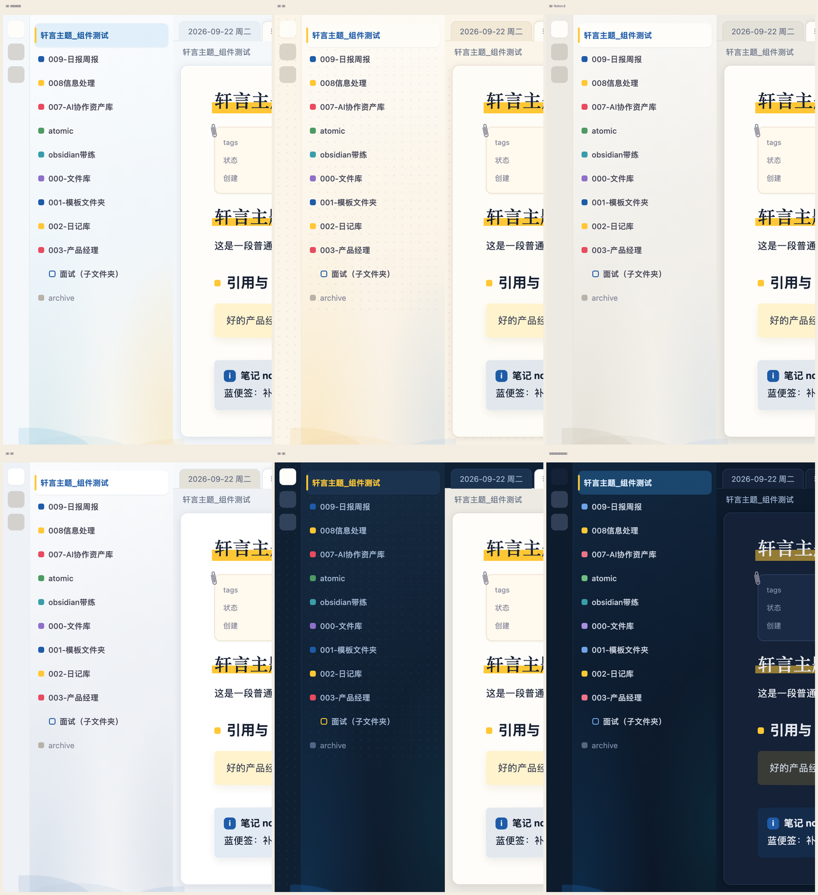

# Deskmate · 桌伴

> 温暖、可爱、专业。给用过 Notion 的人一个回 Obsidian 的理由。
> A warm, friendly Obsidian theme for people who miss Notion's polish. Sticky notes, index cards, a desk lamp, and a breathing desk.


---

## 中文

### 它长什么样

- **一张纸浮在桌上**：正文区是一张有投影的纸，外圈是带流线渐变的桌面，五种侧栏风格可选
- **便利贴是全局语言**：所有 callout 按类型变成蓝 / 绿 / 黄 / 粉 / 紫 / 灰便签，带胶带、微微歪一点；引用块是一张黄便签；弹出通知和悬停预览也贴着胶带
- **彩色文件夹方块**：一级文件夹前一个实心方块，六色循环；子文件夹空心方块继承父级颜色；归档类文件夹自动变灰
- **索引卡属性区**：笔记属性变成一张夹着回形针的索引卡
- **标题有性格**：H1 和笔记标题用宋体类衬线，底下压一条橙色马克笔；H2 前一个橙色小方块，和文件夹方块同一几何语言
- **空白标签页是一张书桌**：电脑、台灯、马克杯、便利贴；台灯光 7 秒一次缓慢呼吸；夜景版台灯是唯一光源
- **动一次就停的动效**：打开笔记时马克笔划过、便利贴贴上、点文件时橙条长出来；全部尊重系统"减弱动态效果"
- **亮暗双模**：暗色是"夜间书房"，不是亮色反相





### 安装

**从社区主题商店**：设置 → 外观 → 主题 → 管理 → 搜索 `Deskmate`。

**手动安装**：下载 `manifest.json` 和 `theme.css`，放进 `你的库/.obsidian/themes/Deskmate/`，然后在 设置 → 外观 → 主题 里选择 Deskmate。

### 可调项（需要 Style Settings 插件）

装上 [Style Settings](https://github.com/mgmeyers/obsidian-style-settings) 后，在 设置 → Style Settings → Deskmate · 桌伴 里：

| 选项 | 默认 | 说明 |
|---|---|---|
| 侧栏风格 | 流线 · 浅蓝灰 | 浅蓝灰 / 奶白 / Notion 灰 / 冷灰 / 墨蓝，都是底色渐变 + 底部流线 |
| 文件夹方块只用品牌蓝 | 关 | 关闭六色循环 |
| H1 标题马克笔 | 开 | 一级标题底下的橙色马克笔 |
| 纸面卡片 | 开 | 正文区浮在桌面上的卡片 |
| 便利贴风格 | 开 | 所有 callout / 引用 / 通知 / 悬停预览都是便利贴 |
| 桌垫点阵 | 开 | 流线侧栏下自动关闭 |
| 台灯光 | 开 | 纸面右上角的暖光，暗色里是阅读灯 |
| 衬线大标题 | 开 | H1 和笔记标题用宋体类衬线 |
| 动效 | 开 | 马克笔划过 / 便利贴贴上 / 选中文件 / 台灯呼吸 |
| 空白页书桌场景 | 开 | 新标签页上的书桌插画 |

没装 Style Settings 也能用，所有默认值已经是推荐值。

### 主题专属语法

```markdown
> [!sticky] 便利贴
> 一张最歪、最黄的便利贴。
```

勾选框支持 `- [ ]`、`- [x]`、`- [-]` 取消、`- [!]` 重要、`- [/]` 进行中、`- [>]` 推迟、`- [?]` 存疑、`- [*]` 星标。

### 已知限制

- 文件夹六色按"同一层里第几个文件夹"着色，新建文件夹后颜色会顺延
- 归档灰只识别名字以 `99` / `archive` 开头或含"归档"的文件夹
- 装了 Iconize（icon-folder）时，有图标的文件夹会自动隐藏方块
- 衬线标题依赖系统里的宋体类字体（macOS 自带"宋体-简"），没有时自动退回黑体
- 需要 Obsidian 1.6 或更新

### 致谢

- 侧栏流线渐变的配色方案来自主题作者提供的设计稿
- 便利贴 callout 的图标来自 Obsidian 内置的 Lucide 图标集

---

## English

### What it looks like

- **A sheet of paper on a desk**: the editor is a card with a soft shadow, the chrome is a desk with flowing gradients; five sidebar styles to pick from
- **Sticky notes everywhere**: every callout becomes a sticky note colored by type, with a strip of tape and a slight tilt; blockquotes are yellow stickies; notices and hover previews get tape too
- **Colored folder squares**: top-level folders get a solid square cycling through six colors; subfolders get a hollow square inheriting the parent color; archive folders turn gray
- **Index-card properties**: the properties block becomes a card held by a paperclip
- **Headings with character**: H1 and the inline title use a serif face with an orange marker underneath; H2 gets a small orange square, the same shape as the folder squares
- **The empty tab is a desk**: a laptop, a lamp, a mug and a sticky note; the lamp light breathes every 7 seconds; at night the lamp is the only light source
- **Motion that settles**: the marker draws itself when you open a note, stickies land, the orange bar grows when you select a file; all of it respects "reduce motion"
- **Light and dark**: dark mode is a night study, not an inverted light mode

### Install

**From the community theme store**: Settings → Appearance → Themes → Manage → search `Deskmate`.

**Manually**: download `manifest.json` and `theme.css` into `<vault>/.obsidian/themes/Deskmate/`, then pick Deskmate under Settings → Appearance → Themes.

### Options (Style Settings plugin)

With [Style Settings](https://github.com/mgmeyers/obsidian-style-settings) installed, open Settings → Style Settings → Deskmate · 桌伴:

| Option | Default | Notes |
|---|---|---|
| Sidebar style | Flow · light blue-gray | light blue-gray / cream / Notion gray / cool gray / ink, all with gradient + flowing arcs |
| Folder squares in brand blue only | off | disables the six-color cycle |
| H1 marker | on | orange marker under level-1 headings |
| Paper card | on | editor floats on the desk |
| Sticky-note style | on | all callouts / quotes / notices / hover previews become stickies |
| Desk-pad dots | on | auto-off under flow sidebars |
| Lamp glow | on | warm glow in the paper's top-right corner; a reading lamp in dark mode |
| Serif titles | on | serif for H1 and inline title |
| Motion | on | marker, stickies, file selection, lamp breathing |
| Desk scene on empty tab | on | the illustration on new tabs |

The theme works without Style Settings; the defaults are the recommended values.

### Theme-specific syntax

```markdown
> [!sticky] Sticky note
> The yellowest, most tilted sticky of them all.
```

Checkboxes: `- [ ]`, `- [x]`, `- [-]` cancelled, `- [!]` important, `- [/]` in progress, `- [>]` deferred, `- [?]` question, `- [*]` starred.

### Known limitations

- Folder colors follow "the n-th folder among its siblings", so adding a folder shifts the colors after it
- Archive gray only matches folders named `99…`, `archive…` or containing "归档"
- With Iconize (icon-folder) installed, folders that have an icon hide their square automatically
- Serif titles rely on a system serif CJK font (macOS ships "Songti SC"); it falls back to sans otherwise
- Requires Obsidian 1.6 or newer

### License

MIT © 2026 轩言PM (lykAntonio)
